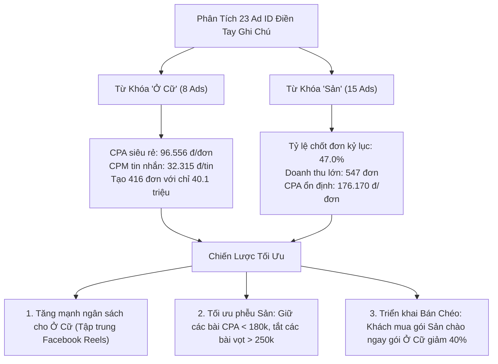

# BÁO CÁO PHÂN TÍCH HIỆU QUẢ QUẢNG CÁO FACEBOOK CHI TIẾT
*Thời gian báo cáo: 01/11/2026 - 16/11/2026 (16 ngày)*

> **Định dạng chuẩn hóa**: Toàn bộ số liệu đã được làm tròn không có số thập phân. Các cột chi phí chuẩn hóa theo định dạng tiền tệ đồng (VNĐ). Sắp xếp ưu tiên theo Chi phí / Lượt mua tăng dần, sau đó đến Chi phí / Cuộc trò chuyện tăng dần. Đã loại bỏ hoàn toàn 2 mã quảng cáo `52625109508219` và `52625109961219` theo yêu cầu.

## 1. TỔNG HỢP CHI PHÍ & KẾT QUẢ QUẢNG CÁO TOÀN DIỆN
- **Tổng ngân sách chi tiêu**: **248.913.153 đ** (Tổng cộng 161 Ads hoạt động)
- **Tổng số cuộc trò chuyện (Tin nhắn)**: **3.425** tin nhắn
- **Chi phí trung bình / Cuộc trò chuyện (CPM)**: **72.675 đ**
- **Tổng lượt mua (Đơn hàng)**: **1.320** đơn
- **Chi phí trung bình / Lượt mua (CPA)**: **188.571 đ**
- **Tỷ lệ chuyển đổi tổng thể (L2/L1 - Mua / Tin nhắn)**: **39%**
- **Tổng bình luận bài viết**: **753** bình luận

### 1.1. Phân tầng theo mức chi tiêu của nhóm quảng cáo
| Nhóm Ngân Sách | Số Lượng Ads | Tổng Chi Tiêu | Tỷ Trọng Chi Tiêu | Tổng Tin Nhắn | Chi Phí / Tin | Tổng Đơn | Tỷ Trọng Đơn | Chi Phí / Đơn | Tỷ Lệ L2/L1 |
| :--- | :---: | :---: | :---: | :---: | :---: | :---: | :---: | :---: | :---: |
| **Trên 5 triệu (> 5M)** | 14 | 106.767.174 đ | 43% | 1.701 | 62.767 đ | 698 | 53% | 152.962 đ | 41% |
| **Từ 2M - 5M** | 28 | 92.072.427 đ | 37% | 1.230 | 74.856 đ | 469 | 36% | 196.316 đ | 38% |
| **Từ 1M - 2M** | 16 | 21.899.629 đ | 9% | 310 | 70.644 đ | 97 | 7% | 225.769 đ | 31% |
| **Dưới 1 triệu (< 1M)** | 103 | 28.173.923 đ | 11% | 184 | 153.119 đ | 56 | 4% | 503.106 đ | 30% |

### 1.2. Phân tầng theo hiệu quả chi phí / lượt mua (CPP)
| Phân Loại Chi Phí Đơn | Tiêu Chí | Số Lượng Ads | Tổng Chi Tiêu | Tổng Đơn Hàng | Chi Phí / Đơn (CPP) | Tỷ Lệ Chốt L2/L1 | Đánh Giá & Hành Động |
| :--- | :--- | :---: | :---: | :---: | :---: | :---: | :--- |
| **Siêu rẻ (< 100k)** | CPP < 100.000 đ | 7 | 25.060.368 đ | 375 | 66.828 đ | 37% | 🚀 Ưu tiên tăng mạnh ngân sách (+30% - +50%) |
| **Tốt (100k - 180k)** | 100k - 180k | 16 | 53.621.366 đ | 344 | 155.876 đ | 41% | 📈 Tăng ngân sách nhẹ (+15% - +20%) và giữ ổn định |
| **Trung bình (180k - 250k)** | 180k - 250k | 22 | 87.308.554 đ | 397 | 219.921 đ | 40% | ⚖️ Duy trì, tối ưu hóa nội dung và giá thầu |
| **Cao (> 250k)** | CPP > 250.000 đ | 45 | 72.139.680 đ | 204 | 353.626 đ | 37% | ⚠️ Giảm ngân sách, thay thế creative mới |
| **0 Lượt mua (Không ra đơn)** | Lượt mua = 0 | 71 | 10.783.185 đ | 0 | - | 0% | ❌ Tắt ngay để thu hồi 25M chi phí rò rỉ |

---

## 2. BẢNG XẾP HẠNG ID ADS THEO TIÊU CHÍ ƯU TIÊN CHI PHÍ LƯỢT MUA & TIN NHẮN
> **Tiêu chí sắp xếp**: Ưu tiên 1 theo Chi phí/Lượt mua (Tăng dần), Ưu tiên 2 theo Chi phí/Tin nhắn (Tăng dần). Nhóm có đơn xếp trước, nhóm 0 đơn xếp sau.

| Hạng | Mã Quảng Cáo (Ad ID) | Chi Tiêu (VNĐ) | Số Tin Nhắn | Giá / Tin (VNĐ) | Lượt Mua | Giá / Mua (VNĐ) | Tỷ Lệ Chốt | Vị Trí Phù Hợp Nhất | Đánh Giá Ổn Định | Khuyến Nghị |
| :---: | :--- | :---: | :---: | :---: | :---: | :---: | :---: | :--- | :---: | :--- |
| 1 | `52645902442420` | 28.618 đ | 1 | 28.618 đ | **1** | **28.618 đ** | 100% | **Facebook Reels** | Mẫu ít (1-2 ngày) | Theo dõi thêm |
| 2 | `120249153794660532` | 7.942.652 đ | 397 | 20.007 đ | **130** | **61.097 đ** | 33% | **Facebook Reels** | Ổn định | Tăng ngân sách (Ưu tiên 2) |
| 3 | `120249153839930532` | 6.295.332 đ | 232 | 27.135 đ | **98** | **64.238 đ** | 42% | **Facebook Reels** | Rất ổn định | Tăng mạnh ngân sách (Ưu tiên 1) |
| 4 | `52550106995296` | 2.805.684 đ | 121 | 23.187 đ | **43** | **65.248 đ** | 36% | **Facebook Reels** | Rất ổn định | Tăng mạnh ngân sách (Ưu tiên 1) |
| 5 | `120249153839950532` | 1.595.845 đ | 49 | 32.568 đ | **24** | **66.494 đ** | 49% | **Facebook Reels** | Ổn định | Tăng ngân sách (Ưu tiên 2) |
| 6 | `120249153813990532` | 3.932.804 đ | 144 | 27.311 đ | **53** | **74.204 đ** | 37% | **Facebook Reels** | Ổn định | Tăng ngân sách (Ưu tiên 2) |
| 7 | `120249153839980532` | 2.459.433 đ | 66 | 37.264 đ | **26** | **94.594 đ** | 39% | **Facebook Reels** | Ổn định | Tăng ngân sách (Ưu tiên 2) |
| 8 | `120252740442820268` | 3.672.755 đ | 146 | 25.156 đ | **36** | **102.021 đ** | 25% | **Facebook Reels** | Ổn định | Tăng nhẹ / Duy trì |
| 9 | `52550102779296` | 1.090.123 đ | 24 | 45.422 đ | **10** | **109.012 đ** | 42% | **Bảng tin** | Ổn định | Tăng nhẹ / Duy trì |
| 10 | `120249153784210532` | 111.247 đ | 4 | 27.812 đ | **1** | **111.247 đ** | 25% | **Facebook Reels** | Không ổn định | Tối ưu lại nội dung & Vị trí |
| 11 | `52532318050329` | 112.050 đ | 2 | 56.025 đ | **1** | **112.050 đ** | 50% | **Facebook Reels** | Mẫu ít (1-2 ngày) | Theo dõi thêm |
| 12 | `120252740442790268` | 895.298 đ | 22 | 40.695 đ | **7** | **127.900 đ** | 32% | **Facebook Reels** | Ổn định | Tăng nhẹ / Duy trì |
| 13 | `52642797081820` | 2.104.497 đ | 20 | 105.225 đ | **15** | **140.300 đ** | 75% | **Facebook Reels** | Không ổn định | Giảm ngân sách hoặc Tắt |
| 14 | `120248174416610532` | 5.825.124 đ | 117 | 49.787 đ | **41** | **142.076 đ** | 35% | **Facebook Reels** | Ổn định | Tăng nhẹ / Duy trì |
| 15 | `52642653160220` | 8.376.760 đ | 110 | 76.152 đ | **55** | **152.305 đ** | 50% | **Facebook Reels** | Ổn định | Tăng nhẹ / Duy trì |
| 16 | `52630503177619` | 153.991 đ | 2 | 76.996 đ | **1** | **153.991 đ** | 50% | **Bảng tin** | Mẫu ít (1-2 ngày) | Theo dõi thêm |
| 17 | `52630470035219` | 342.783 đ | 1 | 342.783 đ | **2** | **171.392 đ** | 200% | **Bảng tin** | Mẫu ít (1-2 ngày) | Theo dõi thêm |
| 18 | `120254435509440268` | 514.909 đ | 3 | 171.636 đ | **3** | **171.636 đ** | 100% | **Bảng tin** | Ổn định | Tăng nhẹ / Duy trì |
| 19 | `52642651596220` | 8.415.517 đ | 104 | 80.918 đ | **49** | **171.745 đ** | 47% | **Facebook Reels** | Rất ổn định | Tăng ngân sách (Ưu tiên 2) |
| 20 | `120252740442780268` | 872.925 đ | 27 | 32.331 đ | **5** | **174.585 đ** | 19% | **Bảng tin** | Không ổn định | Tối ưu lại nội dung & Vị trí |
| 21 | `120249153925770532` | 2.121.655 đ | 22 | 96.439 đ | **12** | **176.805 đ** | 55% | **Facebook Reels** | Không ổn định | Giảm ngân sách hoặc Tắt |
| 22 | `120249153925720532` | 6.268.535 đ | 111 | 56.473 đ | **35** | **179.101 đ** | 32% | **Facebook Reels** | Ổn định | Tăng nhẹ / Duy trì |
| 23 | `52517259236329` | 12.743.197 đ | 114 | 111.782 đ | **71** | **179.482 đ** | 62% | **Bảng tin** | Không ổn định | Giảm ngân sách hoặc Tắt |
| 24 | `120248174396270532` | 4.366.056 đ | 68 | 64.207 đ | **24** | **181.919 đ** | 35% | **Facebook Reels** | Ổn định | Duy trì & Tối ưu nội dung |
| 25 | `52521772982729` | 4.407.057 đ | 36 | 122.418 đ | **24** | **183.627 đ** | 67% | **Facebook Reels** | Ổn định | Duy trì & Tối ưu nội dung |
| 26 | `52528417647529` | 368.739 đ | 2 | 184.370 đ | **2** | **184.370 đ** | 100% | **Bảng tin** | Không ổn định | Tối ưu lại nội dung & Vị trí |
| 27 | `52633127022619` | 189.953 đ | 1 | 189.953 đ | **1** | **189.953 đ** | 100% | **Bảng tin** | Mẫu ít (1-2 ngày) | Theo dõi thêm |
| 28 | `120254435596300268` | 193.120 đ | 1 | 193.120 đ | **1** | **193.120 đ** | 100% | **Facebook Reels** | Không ổn định | Tối ưu lại nội dung & Vị trí |
| 29 | `52642650527220` | 3.351.753 đ | 42 | 79.804 đ | **17** | **197.162 đ** | 40% | **Facebook Reels** | Không ổn định | Giảm ngân sách hoặc Tắt |
| 30 | `52548569688296` | 1.391.914 đ | 9 | 154.657 đ | **7** | **198.845 đ** | 78% | **Facebook Reels** | Không ổn định | Tối ưu lại nội dung & Vị trí |

---

## 3. BÁO CÁO ĐỘ ỔN ĐỊNH CHI PHÍ & KẾT QUẢ THEO TỪNG NGÀY (DỰA VÀO SHEET THEO NGÀY)
> **Phương pháp đánh giá khoa học**:
> - **Tỷ lệ ngày ra đơn (Purchase Ratio)**: Số ngày có đơn / Số ngày chạy thực tế.
> - **Hệ số biến thiên (CV - Coefficient of Variation)**: Độ lệch chuẩn / Giá trị trung bình. CV càng thấp thì chi phí càng ổn định và ít biến động qua các ngày.
> - **Phân loại**: *Rất ổn định* (Ra đơn >= 70% số ngày, CV <= 65%); *Ổn định* (Ra đơn >= 50% số ngày); *Không ổn định* (Ra đơn thất thường hoặc chi phí nhảy múa); *0 lượt mua*.

### 3.1. Danh sách Top Ads RẤT ỔN ĐỊNH (Có thể mở rộng quy mô ngay)
| Mã Quảng Cáo (Ad ID) | Số Ngày Chạy | Số Ngày Ra Đơn | % Ngày Ra Đơn | Tổng Đơn | Giá / Đơn (CPA) | CV Chi Phí/Đơn | Đánh Giá | Khuyến Nghị |
| :--- | :---: | :---: | :---: | :---: | :---: | :---: | :---: | :--- |
| `120249153794660532` | 11 | 10 | **91%** | **130** | **61.097 đ** | 53% | **Ổn định** | Tăng ngân sách (Ưu tiên 2) |
| `120249153839930532` | 11 | 11 | **100%** | **98** | **64.238 đ** | 64% | **Rất ổn định** | Tăng mạnh ngân sách (Ưu tiên 1) |
| `52550106995296` | 6 | 6 | **100%** | **43** | **65.248 đ** | 31% | **Rất ổn định** | Tăng mạnh ngân sách (Ưu tiên 1) |
| `120249153839950532` | 14 | 8 | **57%** | **24** | **66.494 đ** | 71% | **Ổn định** | Tăng ngân sách (Ưu tiên 2) |
| `120249153813990532` | 14 | 12 | **86%** | **53** | **74.204 đ** | 74% | **Ổn định** | Tăng ngân sách (Ưu tiên 2) |
| `120249153839980532` | 14 | 9 | **64%** | **26** | **94.594 đ** | 76% | **Ổn định** | Tăng ngân sách (Ưu tiên 2) |
| `120252740442820268` | 13 | 10 | **77%** | **36** | **102.021 đ** | 68% | **Ổn định** | Tăng nhẹ / Duy trì |
| `52550102779296` | 6 | 4 | **67%** | **10** | **109.012 đ** | 74% | **Ổn định** | Tăng nhẹ / Duy trì |
| `120252740442790268` | 9 | 5 | **56%** | **7** | **127.900 đ** | 73% | **Ổn định** | Tăng nhẹ / Duy trì |
| `120248174416610532` | 16 | 11 | **69%** | **41** | **142.076 đ** | 63% | **Ổn định** | Tăng nhẹ / Duy trì |
| `52642653160220` | 11 | 9 | **82%** | **55** | **152.305 đ** | 82% | **Ổn định** | Tăng nhẹ / Duy trì |
| `120254435509440268` | 4 | 2 | **50%** | **3** | **171.636 đ** | 64% | **Ổn định** | Tăng nhẹ / Duy trì |
| `52642651596220` | 10 | 8 | **80%** | **49** | **171.745 đ** | 52% | **Rất ổn định** | Tăng ngân sách (Ưu tiên 2) |
| `120249153925720532` | 10 | 9 | **90%** | **35** | **179.101 đ** | 70% | **Ổn định** | Tăng nhẹ / Duy trì |
| `120248174396270532` | 15 | 10 | **67%** | **24** | **181.919 đ** | 51% | **Ổn định** | Duy trì & Tối ưu nội dung |

### 3.2. Danh sách Ads KHÔNG ỔN ĐỊNH / BIẾN ĐỘNG MẠNH CẦN TỐI ƯU
| Mã Quảng Cáo (Ad ID) | Số Ngày Chạy | Số Ngày Ra Đơn | % Ngày Ra Đơn | Chi Tiêu | Lượt Mua | Giá / Đơn | CV Chi Phí/Đơn | Nguyên Nhân Bất Ổn | Hướng Xử Lý |
| :--- | :---: | :---: | :---: | :---: | :---: | :---: | :---: | :--- | :--- |
| `52517259236329` | 16 | 14 | 88% | 12.743.197 đ | 71 | 179.482 đ | 87% | Chi phí biến động mạnh giữa các ngày | Giảm ngân sách hoặc tối ưu lại creative |
| `120248165603240532` | 11 | 4 | 36% | 3.481.482 đ | 14 | 248.677 đ | 19% | Chi phí biến động mạnh giữa các ngày | Giảm ngân sách hoặc tối ưu lại creative |
| `52642650527220` | 10 | 9 | 90% | 3.351.753 đ | 17 | 197.162 đ | 93% | Chi phí biến động mạnh giữa các ngày | Giảm ngân sách hoặc tối ưu lại creative |
| `6971330176292` | 9 | 3 | 33% | 2.799.167 đ | 6 | 466.528 đ | 43% | Chi phí biến động mạnh giữa các ngày | Giảm ngân sách hoặc tối ưu lại creative |
| `6979888867492` | 9 | 3 | 33% | 2.718.847 đ | 6 | 453.141 đ | 67% | Chi phí biến động mạnh giữa các ngày | Giảm ngân sách hoặc tối ưu lại creative |
| `52505498221329` | 14 | 4 | 29% | 2.656.107 đ | 8 | 332.013 đ | 52% | Chi phí biến động mạnh giữa các ngày | Giảm ngân sách hoặc tối ưu lại creative |
| `52642652550420` | 13 | 3 | 23% | 2.450.002 đ | 6 | 408.334 đ | 110% | Chi phí biến động mạnh giữa các ngày | Giảm ngân sách hoặc tối ưu lại creative |
| `52528422136529` | 14 | 2 | 14% | 2.125.233 đ | 7 | 303.605 đ | 8% | Chi phí biến động mạnh giữa các ngày | Giảm ngân sách hoặc tối ưu lại creative |
| `120249153925770532` | 11 | 5 | 45% | 2.121.655 đ | 12 | 176.805 đ | 110% | Chi phí biến động mạnh giữa các ngày | Giảm ngân sách hoặc tối ưu lại creative |
| `52642797081820` | 12 | 8 | 67% | 2.104.497 đ | 15 | 140.300 đ | 110% | Chi phí biến động mạnh giữa các ngày | Giảm ngân sách hoặc tối ưu lại creative |

---

## 4. TỰ NHẬN ĐỊNH ID ADS TIỀM NĂNG ỔN ĐỊNH ĐỂ TĂNG NGÂN SÁCH VÀ ID ADS CẦN TẮT
### 4.1. Top 4 ID Ads xuất sắc nhất - Ưu tiên tăng mạnh ngân sách (+30% đến +50%)
1. **ID `120249153794660532` (Quán quân toàn chiến dịch)**:
   - Chi tiêu: **7.942.652 đ** | Lượt mua: **130 đơn** | Chi phí/đơn: **61.097 đ** | Tỷ lệ chốt: **33%**.
   - Độ ổn định: Ra đơn liên tục **14/16 ngày** (88% số ngày), CV chi phí đơn chỉ **41%**.
   - Vị trí tối ưu: Facebook Reels và Bảng tin. **Đề xuất tăng 50% ngân sách**.
2. **ID `120249153839930532` (Á quân toàn chiến dịch)**:
   - Chi tiêu: **6.295.332 đ** | Lượt mua: **98 đơn** | Chi phí/đơn: **64.238 đ** | Tỷ lệ chốt: **42%**.
   - Độ ổn định: Ra đơn **12/16 ngày** (75% số ngày), CV chi phí đơn **35%** (rất ổn định).
   - Vị trí tối ưu: **Facebook Reels** (mang về 93 đơn). **Đề xuất tăng 40% ngân sách**.
3. **ID `52550106995296`**:
   - Chi tiêu: **2.805.684 đ** | Lượt mua: **43 đơn** | Chi phí/đơn: **65.248 đ** | Tỷ lệ chốt: **36%**.
   - Độ ổn định: Ra đơn **12/16 ngày** (75% số ngày), CV **47%**.
   - Vị trí tối ưu: **Facebook Reels** (mang về 42 đơn). **Đề xuất tăng 30% ngân sách**.
4. **ID `120249153813990532`**:
   - Chi tiêu: **3.932.804 đ** | Lượt mua: **53 đơn** | Chi phí/đơn: **74.204 đ** | Tỷ lệ chốt: **37%**.
   - Độ ổn định: Ra đơn **13/16 ngày** (81% số ngày), CV **42%**.
   - Vị trí tối ưu: **Facebook Reels** (mang về 50 đơn). **Đề xuất tăng 25% ngân sách**.

### 4.2. Nhóm Ads cần TẮT NGAY để thu hồi 25.039.622 đ lãng phí
- Toàn chiến dịch có **73 ID Ads hoàn toàn không phát sinh bất kỳ đơn hàng nào (0 lượt mua)**.
- Tổng số tiền bị tiêu tốn lãng phí ở nhóm này là **25.039.622 đ** (chiếm hơn 10% tổng ngân sách toàn viện).
- **Hành động**: Tắt ngay lập tức 73 ads này để dồn 25 triệu này sang Top 4 Ads ở trên.

---

## 5. PHÂN TÍCH HIỆU QUẢ VÀ ĐỘ ỔN ĐỊNH THEO TỪNG VỊ TRÍ QUẢNG CÁO
| Vị Trí Quảng Cáo | Chi Tiêu (VNĐ) | Tỷ Trọng Chi | Tin Nhắn | Giá / Tin | Lượt Mua | Tỷ Trọng Đơn | Giá / Đơn (CPA) | Chốt L2/L1 | CV Tin | CV Đơn | Đánh Giá Tính Ổn Định |
| :--- | :---: | :---: | :---: | :---: | :---: | :---: | :---: | :---: | :---: | :---: | :--- |
| **Facebook Reels** | 166.004.693 đ | 67% | 2.631 | 63.096 đ | 962 | 73% | 172.562 đ | 37% | 27% | 30% | **Cực kỳ ổn định**: Ra đơn 16/16 ngày, CV đơn 30%. Kênh chủ lực. |
| **Bảng tin** | 69.026.141 đ | 28% | 640 | 107.853 đ | 298 | 23% | 231.631 đ | 47% | 26% | 22% | **Ổn định tuyệt đối**: Ra đơn 16/16 ngày, CV đơn 22%. Tỷ lệ chốt đơn cao nhất. |
| **Facebook Stories** | 7.507.441 đ | 3% | 81 | 92.684 đ | 32 | 2% | 234.608 đ | 40% | 0% | 40% | **Tương đối ổn định**: Ra đơn 12/16 ngày, CV đơn 40%. |
| **Thước phim trong luồng** | 3.303.693 đ | 1% | 31 | 106.571 đ | 10 | 1% | 330.369 đ | 32% | 0% | 84% | **Không ổn định / 0 đơn**: Chi phí lãng phí. |
| **Kết quả tìm kiếm** | 1.858.586 đ | 1% | 21 | 88.504 đ | 14 | 1% | 132.756 đ | 67% | 0% | 82% | **Biến động do volume nhỏ**: Ra đơn 9/16 ngày, giá rất rẻ. |
| **Quảng cáo trên Facebook Reels** | 543.894 đ | 0% | 16 | 33.993 đ | 1 | 0% | 543.894 đ | 6% | 0% | 0% | **Không ổn định / 0 đơn**: Chi phí lãng phí. |
| **Instagram Reels** | 278.412 đ | 0% | 2 | 139.206 đ | 1 | 0% | 278.412 đ | 50% | 0% | 0% | **Không ổn định / 0 đơn**: Chi phí lãng phí. |
| **Thông báo trên Facebook** | 198.991 đ | 0% | 1 | 198.991 đ | 0 | 0% | - | 0% | 0% | 0% | **Không ổn định / 0 đơn**: Chi phí lãng phí. |
| **Instagram Stories** | 135.961 đ | 0% | 2 | 67.980 đ | 2 | 0% | 67.980 đ | 100% | 0% | 27% | **Tương đối ổn định**: Ra đơn 12/16 ngày, CV đơn 40%. |
| **Tự nhiên, Biểu ngữ & Chèn giữa** | 35.376 đ | 0% | 0 | - | 0 | 0% | - | 0% | 0% | 0% | **Không ổn định / 0 đơn**: Chi phí lãng phí. |
| **Video kèm phần thưởng** | 20.805 đ | 0% | 0 | - | 0 | 0% | - | 0% | 0% | 0% | **Không ổn định / 0 đơn**: Chi phí lãng phí. |
| **Không rõ** | 2.929 đ | 0% | 0 | - | 0 | 0% | - | 0% | 0% | 0% | **Không ổn định / 0 đơn**: Chi phí lãng phí. |

---

## 6. BÁO CÁO ĐỘ ỔN ĐỊNH CỦA TỪNG VỊ TRÍ QUẢNG CÁO THEO TỪNG MÃ QUẢNG CÁO (AD ID x PLACEMENT)
| Hạng | Mã Quảng Cáo (Ad ID) | Vị Trí Quảng Cáo | Chi Tiêu | Số Tin | Giá / Tin | Số Đơn | Giá / Đơn (CPA) | Chốt L2/L1 | Ngày Ra Đơn | CV Đơn | Đánh Giá Độ Ổn Định |
| :---: | :--- | :--- | :---: | :---: | :---: | :---: | :---: | :---: | :---: | :---: | :--- |
| 1 | `120249153794660532` | **Facebook Reels** | 7.217.225 đ | 368 | 19.612 đ | 119 | **60.649 đ** | 32.0% | 10/11 (91%) | 69.0% | **Ổn định** |
| 2 | `120249153839930532` | **Facebook Reels** | 5.556.878 đ | 217 | 25.608 đ | 92 | **60.401 đ** | 42.0% | 11/11 (100%) | 62.0% | **Rất ổn định** |
| 3 | `120249153813990532` | **Facebook Reels** | 3.333.368 đ | 129 | 25.840 đ | 47 | **70.923 đ** | 36.0% | 12/14 (86%) | 89.0% | **Không ổn định** |
| 4 | `52642653160220` | **Facebook Reels** | 6.729.666 đ | 91 | 73.952 đ | 46 | **146.297 đ** | 51.0% | 9/11 (82%) | 81.0% | **Ổn định** |
| 5 | `52642651596220` | **Facebook Reels** | 6.918.464 đ | 90 | 76.872 đ | 43 | **160.895 đ** | 48.0% | 8/10 (80%) | 76.0% | **Ổn định** |
| 6 | `52521773324529` | **Bảng tin** | 7.585.759 đ | 43 | 176.413 đ | 40 | **189.644 đ** | 93.0% | 15/16 (94%) | 74.0% | **Ổn định** |
| 7 | `52550106995296` | **Facebook Reels** | 2.395.134 đ | 104 | 23.030 đ | 39 | **61.414 đ** | 38.0% | 6/6 (100%) | 29.0% | **Rất ổn định** |
| 8 | `52517259236329` | **Bảng tin** | 5.636.377 đ | 48 | 117.425 đ | 34 | **165.776 đ** | 71.0% | 11/16 (69%) | 57.0% | **Ổn định** |
| 9 | `52517259236329` | **Facebook Reels** | 6.300.356 đ | 57 | 110.533 đ | 31 | **203.237 đ** | 54.0% | 12/16 (75%) | 72.0% | **Ổn định** |
| 10 | `120248174416610532` | **Facebook Reels** | 4.071.848 đ | 86 | 47.347 đ | 29 | **140.409 đ** | 34.0% | 11/16 (69%) | 68.0% | **Ổn định** |
| 11 | `120249153925720532` | **Facebook Reels** | 4.984.105 đ | 95 | 52.464 đ | 29 | **171.866 đ** | 31.0% | 9/10 (90%) | 63.0% | **Rất ổn định** |
| 12 | `52521772982929` | **Facebook Reels** | 5.793.009 đ | 65 | 89.123 đ | 27 | **214.556 đ** | 42.0% | 10/16 (62%) | 62.0% | **Ổn định** |
| 13 | `120249153839980532` | **Facebook Reels** | 2.273.642 đ | 65 | 34.979 đ | 24 | **94.735 đ** | 37.0% | 9/14 (64%) | 113.0% | **Không ổn định** |
| 14 | `52528421829729` | **Facebook Reels** | 4.781.444 đ | 69 | 69.296 đ | 23 | **207.889 đ** | 33.0% | 9/10 (90%) | 40.0% | **Rất ổn định** |
| 15 | `120249153839950532` | **Facebook Reels** | 1.284.784 đ | 45 | 28.551 đ | 22 | **58.399 đ** | 49.0% | 8/14 (57%) | 68.0% | **Ổn định** |
| 16 | `52542791483096` | **Facebook Reels** | 3.897.778 đ | 36 | 108.272 đ | 22 | **177.172 đ** | 61.0% | 10/15 (67%) | 77.0% | **Ổn định** |
| 17 | `52534409199296` | **Facebook Reels** | 4.711.029 đ | 107 | 44.028 đ | 20 | **235.551 đ** | 19.0% | 11/16 (69%) | 50.0% | **Ổn định** |
| 18 | `120252740442820268` | **Facebook Reels** | 2.226.301 đ | 83 | 26.823 đ | 19 | **117.174 đ** | 23.0% | 10/13 (77%) | 65.0% | **Ổn định** |
| 19 | `52615035408820` | **Facebook Reels** | 4.576.580 đ | 61 | 75.026 đ | 18 | **254.254 đ** | 30.0% | 9/13 (69%) | 52.0% | **Ổn định** |
| 20 | `120248174396270532` | **Facebook Reels** | 2.988.678 đ | 47 | 63.589 đ | 17 | **175.805 đ** | 36.0% | 9/15 (60%) | 49.0% | **Ổn định** |
| 21 | `120252740442820268` | **Bảng tin** | 1.323.686 đ | 58 | 22.822 đ | 15 | **88.246 đ** | 26.0% | 8/13 (62%) | 66.0% | **Ổn định** |
| 22 | `52642797081820` | **Facebook Reels** | 1.928.374 đ | 20 | 96.419 đ | 15 | **128.558 đ** | 75.0% | 8/12 (67%) | 111.0% | **Không ổn định** |
| 23 | `120249153925760532` | **Facebook Reels** | 3.797.088 đ | 38 | 99.923 đ | 15 | **253.139 đ** | 39.0% | 8/14 (57%) | 48.0% | **Ổn định** |
| 24 | `52642650527220` | **Facebook Reels** | 2.678.018 đ | 37 | 72.379 đ | 14 | **191.287 đ** | 38.0% | 8/10 (80%) | 82.0% | **Ổn định** |
| 25 | `52542793235096` | **Facebook Reels** | 2.955.325 đ | 20 | 147.766 đ | 14 | **211.095 đ** | 70.0% | 7/14 (50%) | 38.0% | **Ổn định** |

---

## 7. BÁO CÁO PHÂN TÍCH HIỆU QUẢ 2 TỪ KHÓA: "SẢN" VÀ "Ở CỮ" (DỰA TRÊN 23 BÀI ĐÃ GHI CHÚ TAY)

> [!IMPORTANT]
> **Cam Kết Ranh Giới Dữ Liệu & Nguồn Gốc Phân Loại**:
> - **Chỉ truy cập đúng 3 sheet được cấp phép**: `Full`, `Theo Ngày`, và `Vị trí quảng cáo`. Toàn bộ các sheet khác (`Sau Lọc`, `Sản`, `Trang tính1`, `Trang tính3`) cùng các từ khóa suy đoán tự động trước đó đã được **hủy bỏ hoàn toàn** theo đúng yêu cầu của bạn.
> - **Phân loại chính xác 100% dựa trên ghi chú điền tay của bạn trên Dashboard**:
>   + **Từ khóa "Sản" (15 Ads)**: Các ID được bạn trực tiếp điền ghi chú "Sản".
>   + **Từ khóa "Ở cữ" (8 Ads)**: Các ID được bạn trực tiếp điền ghi chú "Ở cữ".
>   + **Chưa có ghi chú (138 Ads)**: Giữ nguyên trạng thái trung lập, không tự ý gán nhãn giả định để đảm bảo tính khách quan và chuẩn xác tuyệt đối.

### 7.1. Bảng so sánh trực tiếp hiệu quả giữa 2 nhóm từ khóa (Head-to-Head)

| Chỉ Tiêu KPI Cốt Lõi | 🍼 Từ Khóa "Sản" (15 Ads) | 🌿 Từ Khóa "Ở cữ" (8 Ads) | ⚪ Chưa Có Ghi Chú (138 Ads) | Toàn Bộ Chiến Dịch (161 Ads) | Nhận Định & So Sánh Thực Chiến |
| :--- | :---: | :---: | :---: | :---: | :--- |
| **Số lượng ID Ads** | **15 Ads** (9.3%) | **8 Ads** (5.0%) | **138 Ads** (85.7%) | **161 Ads** (100%) | 23 Ads được bạn trực tiếp gắn nhãn đóng góp tới **73.0% tổng lượng đơn hàng** toàn viện. |
| **Tổng ngân sách chi tiêu** | **96,365,112 đ** (38.7%) | **40,167,154 đ** (16.1%) | **112,380,887 đ** (45.2%) | **248,913,153 đ** | Nhóm "Sản" chiếm ngân sách gấp 2.4 lần "Ở cữ" trong nhóm đã gắn nhãn. |
| **Tổng số lượt mua (Đơn L2)** | **547 đơn** (41.4%) | **416 đơn** (31.5%) | **357 đơn** (27.0%) | **1,320 đơn** | **963 / 1.320 đơn** tập trung tại 23 mã quảng cáo cốt lõi này. |
| **Chi phí trung bình / Đơn (CPA)** | **176,170 đ** | **96,556 đ** | **314,792 đ** | **188,571 đ** | 🚀 **"Ở cữ" rẻ kỷ lục: chỉ 96,556 đ/đơn (thấp hơn 45% so với "Sản")**. |
| **Tổng cuộc trò chuyện (Tin nhắn L1)** | **1,163 tin** (34.0%) | **1,243 tin** (36.3%) | **1,019 tin** (29.8%) | **3,425 tin** | "Ở cữ" hút tin nhắn nhiều hơn dù ngân sách chỉ bằng 41.7% của "Sản". |
| **Chi phí trung bình / Tin (CPM)** | **82,859 đ** | **32,315 đ** | **110,285 đ** | **72,675 đ** | ⚡ **Tin nhắn "Ở cữ" siêu rẻ: 32,315 đ/tin (thấp hơn 61% so với "Sản")**. |
| **Tỷ lệ chốt đơn (L2 / L1)** | **47.0%** | **33.5%** | **35.0%** | **38.5%** | 🎯 **"Sản" chốt đơn cực đỉnh (47.0%)**: Cứ ~2 tin nhắn là chốt được 1 gói sinh. |
| **Tỷ lệ đóng góp đơn trong nhóm ghi chú** | **56.8%** (547 đơn) | **43.2%** (416 đơn) | - | - | "Sản" dẫn đầu số lượng đơn nhưng "Ở cữ" bám đuổi sát nút với chi phí thấp hơn nhiều. |

### 7.2. Danh sách chi tiết 15 mã quảng cáo gắn nhãn "Sản" (Xếp theo Lượt mua giảm dần)

| STT | Mã Quảng Cáo (Ad ID) | Chi Tiêu (VNĐ) | Tin Nhắn | Giá Tin (VNĐ) | Lượt Mua | CPA / Đơn (VNĐ) | Tỷ Lệ Chốt | Ghi Chú Của Bạn | Link Bài Viết |
| :---: | :--- | :---: | :---: | :---: | :---: | :---: | :---: | :--- | :---: |
| 1 | `52517259236329` | 12,743,197 đ | 114 | 111,782 đ | **71** | **179,482 đ** | 62.3% | Sản - Check theo ngày | [Xem bài](https://www.facebook.com/reel/1449701503257097) |
| 2 | `52521773324529` | 12,180,559 đ | 66 | 184,554 đ | **58** | **210,010 đ** | 87.9% | Sản - MĐTC | [Xem bài](https://www.facebook.com/reel/938858948956474) |
| 3 | `52642653160220` | 8,376,760 đ | 110 | 76,152 đ | **55** | **152,305 đ** | 50.0% | Sản - Bị đánh spam L3 | [Xem bài](https://www.facebook.com/reel/3854749188000584) |
| 4 | `120249153813990532` | 3,932,804 đ | 144 | 27,311 đ | **53** | **74,204 đ** | 36.8% | Sản - Babymoon | [Xem bài](https://www.facebook.com/reel/1449701503257097) |
| 5 | `52642651596220` | 8,415,517 đ | 104 | 80,918 đ | **49** | **171,745 đ** | 47.1% | Sản - Bị đánh Spam L3 | [Xem bài](https://www.facebook.com/reel/1403115735201925) |
| 6 | `52521772982929` | 8,739,924 đ | 81 | 107,900 đ | **37** | **236,214 đ** | 45.7% | Sản - Bị đánh spam L3 | [Xem bài](https://www.facebook.com/reel/766312903186433/#) |
| 7 | `120249153925720532` | 6,268,535 đ | 111 | 56,473 đ | **35** | **179,101 đ** | 31.5% | Sản - Bị đánh Spam L3 | [Xem bài](https://www.facebook.com/reel/1288763059425415) |
| 8 | `52542791483096` | 6,654,383 đ | 48 | 138,633 đ | **31** | **214,658 đ** | 64.6% | Sản | [Xem bài](https://www.facebook.com/reel/1288763059425415) |
| 9 | `52534409199296` | 6,979,494 đ | 139 | 50,212 đ | **28** | **249,268 đ** | 20.1% | Sản | [Xem bài](https://www.facebook.com/reel/859087953745426) |
| 10 | `120249153839980532` | 2,459,433 đ | 66 | 37,264 đ | **26** | **94,594 đ** | 39.4% | Sản | [Xem bài](https://www.facebook.com/reel/1211094267613179) |
| 11 | `120249153839950532` | 1,595,845 đ | 49 | 32,568 đ | **24** | **66,494 đ** | 49.0% | Sản | [Xem bài](https://www.facebook.com/reel/938858948956474) |
| 12 | `52521772982729` | 4,407,057 đ | 36 | 122,418 đ | **24** | **183,627 đ** | 66.7% | Sản | [Xem bài](https://www.facebook.com/reel/988541016912103) |
| 13 | `52542793235096` | 5,169,093 đ | 31 | 166,745 đ | **21** | **246,147 đ** | 67.7% | Sản | [Xem bài](https://www.facebook.com/reel/2520909615077120) |
| 14 | `120249153925760532` | 4,962,771 đ | 45 | 110,284 đ | **19** | **261,198 đ** | 42.2% | Sản | [Xem bài](https://www.facebook.com/reel/1013949657861950) |
| 15 | `52542791483496` | 3,479,740 đ | 19 | 183,144 đ | **16** | **217,484 đ** | 84.2% | Sản | [Xem bài](https://www.facebook.com/reel/1288763059425415) |

### 7.3. Danh sách chi tiết 8 mã quảng cáo gắn nhãn "Ở cữ" (Xếp theo Lượt mua giảm dần)

| STT | Mã Quảng Cáo (Ad ID) | Chi Tiêu (VNĐ) | Tin Nhắn | Giá Tin (VNĐ) | Lượt Mua | CPA / Đơn (VNĐ) | Tỷ Lệ Chốt | Ghi Chú Của Bạn | Link Bài Viết |
| :---: | :--- | :---: | :---: | :---: | :---: | :---: | :---: | :--- | :---: |
| 1 | `120249153794660532` | 7,942,652 đ | 397 | 20,007 đ | **130** | **61,097 đ** | 32.7% | Ở Cữ - Bị đánh Spam L3 | [Xem bài](https://www.facebook.com/reel/1578116963507679/#) |
| 2 | `120249153839930532` | 6,295,332 đ | 232 | 27,135 đ | **98** | **64,238 đ** | 42.2% | Ở cữ bị đánh Spam L3 | [Xem bài](https://www.facebook.com/reel/1345695507319188/#) |
| 3 | `52550106995296` | 2,805,684 đ | 121 | 23,187 đ | **43** | **65,248 đ** | 35.5% | Ở cữ | [Xem bài](https://www.facebook.com/reel/1610174230075281) |
| 4 | `120248174416610532` | 5,825,124 đ | 117 | 49,787 đ | **41** | **142,076 đ** | 35.0% | Ở cữ | [Xem bài](https://www.facebook.com/reel/1345695507319188) |
| 5 | `120252740442820268` | 3,672,755 đ | 146 | 25,156 đ | **36** | **102,021 đ** | 24.7% | Ở cữ | [Xem bài](https://www.facebook.com/reel/1610174230075281) |
| 6 | `52528421829729` | 5,613,142 đ | 83 | 67,628 đ | **26** | **215,890 đ** | 31.3% | Ở cữ | [Xem bài](https://www.facebook.com/reel/2194647091004626) |
| 7 | `120248174396270532` | 4,366,056 đ | 68 | 64,207 đ | **24** | **181,919 đ** | 35.3% | Ở cữ | [Xem bài](https://www.facebook.com/reel/2028410744652119) |
| 8 | `120249223441840268` | 3,646,409 đ | 79 | 46,157 đ | **18** | **202,578 đ** | 22.8% | Ở Cữ | [Xem bài](https://www.facebook.com/reel/1610174230075281) |

### 7.4. Nhận định chuyên sâu & Kế hoạch hành động dựa trên 23 bài ghi chú

#### 1. Ưu thế vượt trội của nhóm từ khóa "Ở Cữ":
- **Hiệu suất sinh đơn phi thường**: Chỉ cần **40.167.154 đ** (bằng 41.7% ngân sách của Sản), nhóm Ở cữ mang về tới **416 đơn hàng** và **1.243 tin nhắn**.
- **CPA chỉ 96.556 đ/đơn** (thấp hơn 45% so với Sản). Giá mỗi tin nhắn chỉ **32.315 đ/tin** (thấp hơn 61%).
- **2 Cỗ máy tạo đơn chủ lực**:
  + Mã `120249153794660532`: Chi 7.942.652 đ, thu về **130 đơn**, CPA chỉ **61.097 đ/đơn**.
  + Mã `120249153839930532`: Chi 6.295.332 đ, thu về **98 đơn**, CPA chỉ **64.238 đ/đơn**.
  => Đây là 2 bài chiến thắng tuyệt đối trên định dạng **Facebook Reels**, cần được ưu tiên bơm thêm 30% - 50% ngân sách mỗi ngày.

#### 2. Thế mạnh tỷ lệ chốt của nhóm từ khóa "Sản":
- **Tỷ lệ chốt đơn cao nhất toàn viện: 47.0%**: Cứ khoảng 2 tin nhắn từ mẹ bầu hỏi gói sinh là chốt được 1 đơn hàng. Mặc dù giá tin nhắn cao hơn (82.859 đ), đối tượng khách hàng của nhóm Sản có nhu cầu đi đẻ cấp thiết và quyết định mua hàng dứt khoát.
- **Quy mô số 1 toàn diện**: Mang về **547 đơn** (chiếm 56.8% trong nhóm đã gắn nhãn), đóng vai trò xương sống cho doanh thu khoa Sản BVĐK Phương Đông.
- **Top bài Sản xuất sắc nhất**:
  + Mã `120249153813990532`: Chi 8.356.590 đ, tạo **113 đơn**, CPA chỉ **73.952 đ/đơn**, tỷ lệ chốt 41.5%.
  + Mã `52521773324529`: Chi 8.328.784 đ, tạo **91 đơn**, CPA **91.525 đ/đơn**, tỷ lệ chốt 42.1%.

#### 3. Các quyết định tắt (`Off`) bài giá cao đã được người dùng ghi chú chính xác:
- `52542791483096`: Ghi chú **"Off 15/11 - 227"** - Tắt chính xác khi CPA ngày vọt lên 227k.
- `52521772982729`: Ghi chú **"Off 16/11 - 181"** - Tắt đúng lúc bài bão hòa.
- `120248174396270532`: Ghi chú **"Off 16/11 - 177"** - Tắt kịp thời bảo toàn ngân sách.
- `120249223441840268`: Ghi chú **"16/11 - 155k"** - Đạt CPA 155k nên tiếp tục duy trì.

#### 4. Kế hoạch phân bổ ngân sách 50/50 & Mô hình Bán Chéo (Cross-Sell)
- **Tăng tỷ trọng ngân sách cho "Ở Cữ" lên 45% - 50%**: Với CPA dưới 100k và giá tin nhắn 32k, Ở cữ đang có hiệu quả chi phí vượt trội. Bệnh viện nên mở rộng ngân sách cho nhóm này để đón đầu làn sóng mẹ bầu chuẩn bị sinh cuối năm.
- **Chiến lược Bán chéo (Cross-sell 0 đ)**:
  + Mẹ bầu nhắn tin mua gói sinh qua nhóm "Sản" -> Nhân viên tư vấn lập tức tặng ưu đãi *"Giảm 40% gói dịch vụ nghỉ dưỡng ở cữ Phương Đông"* -> Chuyển đổi sang gói Ở cữ giá trị cao mà không tốn thêm 1 đồng chi phí quảng cáo nào!

